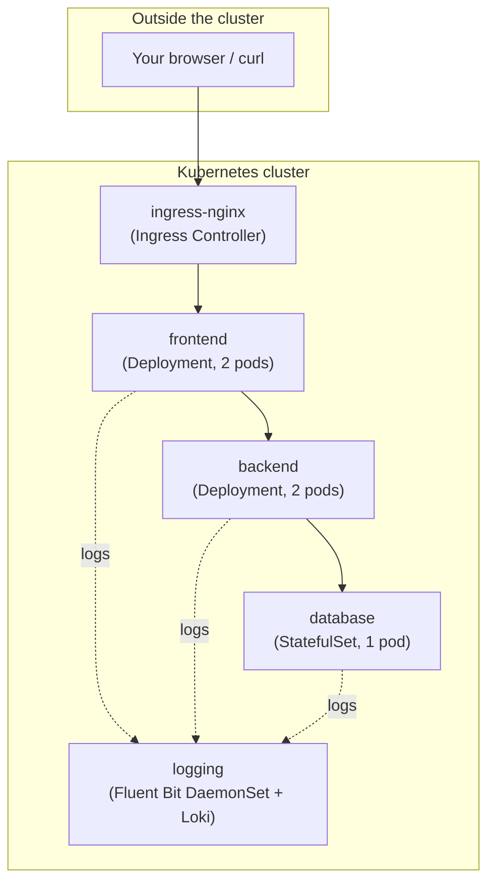
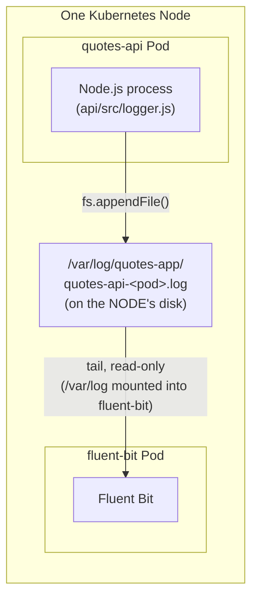

# Project Guide: 3-Tier App + Centralized Logging on Kubernetes

This is a from-scratch, line-by-line walkthrough of this repository for someone who is new to Kubernetes. It covers:

1. [The big picture](#1-the-big-picture) — what runs, where, and why
2. [The three application tiers](#2-the-three-application-tiers) — frontend, backend, database — with exact file/line references
3. [How the tiers talk to each other](#3-how-the-tiers-talk-to-each-other) — Services, DNS names, ports, env vars (table + line numbers)
4. [Getting traffic in: Ingress](#4-getting-traffic-in-ingress)
5. [The logging and observability stack](#5-the-logging-and-observability-stack) — Fluent Bit, the shared volume, Loki
6. [Running the project](#6-running-the-project) — with and without Loki
7. [Verifying logs](#7-verifying-logs) — `kubectl logs`, the PVC, and Loki (LogQL)
8. [A single request, traced end-to-end](#8-a-single-request-traced-end-to-end)
9. [Troubleshooting / FAQ](#9-troubleshooting--faq)
10. [Cleanup](#10-cleanup)

Every file path below is a relative link you can click; line numbers refer to the state of the files at the time this guide was written (search for the quoted snippet if a line has since shifted).

---

## 1. The big picture

This is a classic **3-tier web application** — frontend, backend API, database — deployed to Kubernetes as three separate **namespaces**, plus two supporting namespaces for ingress (how traffic gets in) and logging (how we observe what's happening).

| Namespace | What lives there | Why it's separate |
|---|---|---|
| `frontend` | The web UI (Node.js + EJS templates) | Only this tier should be reachable from outside the cluster |
| `backend` | The REST API (Node.js + Express) | Only the frontend should be able to call it |
| `database` | MySQL | Only the API should be able to reach it |
| `ingress-nginx` | The nginx Ingress Controller | Cluster-wide traffic gateway, not tied to one app |
| `logging` | Fluent Bit (DaemonSet) + Loki (optional) | Cross-cutting concern: collects logs from *every* namespace |

Namespaces are just a way to group and isolate Kubernetes objects (Pods, Services, ConfigMaps, ...) that belong together — they're created once, up front, by [k8s/namespaces.yaml](k8s/namespaces.yaml):

```yaml
# k8s/namespaces.yaml (5 Namespace objects, separated by "---")
database, backend, frontend, ingress-nginx, logging
```

Everything else in [k8s/](k8s) is organized to match: [k8s/database/](k8s/database), [k8s/backend/](k8s/backend), [k8s/frontend/](k8s/frontend), [k8s/ingress-nginx/](k8s/ingress-nginx), [k8s/logging/](k8s/logging).



---

## 2. The three application tiers

### 2.1 Frontend — [app/](app)

A small Express app that renders HTML (EJS templates) and talks to the API over HTTP. It has **no direct database access** — it only ever calls the backend.

- Entry point: [app/server.js](app/server.js) — starts the HTTP server.
- Routes/logic: [app/src/app.js](app/src/app.js) — every page (`/`, `/quotes/random`, POST `/`, POST `/quotes/:id/delete`) calls the API via `axios` and renders a view.
- New in this guide's session: [app/src/logger.js](app/src/logger.js) — a tiny structured logger (explained in [§5](#5-the-logging-and-observability-stack)).

Key line: the frontend finds the API through an environment variable, **not** a hardcoded address:

```js
// app/src/app.js:28
const API_URL = process.env.API_URL || "http://localhost:5001";
```

That `API_URL` is injected by Kubernetes — see [§3](#3-how-the-tiers-talk-to-each-other).

### 2.2 Backend (API) — [api/](api)

A REST API (Express + `mysql2`) that owns all database access.

- Entry point: [api/server.js](api/server.js).
- Routes: [api/src/routes/quotes.routes.js](api/src/routes/quotes.routes.js) (CRUD on `/api/quotes`) and [api/src/routes/health.routes.js](api/src/routes/health.routes.js) (`/health`, `/ready`).
- Business logic: [api/src/controllers/quotes.controller.js](api/src/controllers/quotes.controller.js).
- Database connection: [api/src/config/db.js](api/src/config/db.js).

Key lines — the API also reads everything it needs from the environment, never hardcoded:

```js
// api/src/config/db.js:3-8
const pool = mysql.createPool({
  host: process.env.MYSQL_HOST || "db",
  user: process.env.MYSQL_USER || "user",
  password: process.env.MYSQL_PASSWORD || "password",
  database: process.env.MYSQL_DB || "quotesdb",
});
```

There's also a **readiness probe** worth knowing about as a Kubernetes pattern — it's not just "is the process alive", it's "can I actually serve a request":

```js
// api/src/routes/health.routes.js:10-17
router.get("/ready", async (req, res) => {
  try {
    await pool.query("SELECT 1");
    res.status(200).json({ status: "ready" });
  } catch (err) {
    res.status(503).json({ status: "not ready", error: err.message });
  }
});
```

### 2.3 Database — MySQL, [k8s/database/statefulset.yaml](k8s/database/statefulset.yaml)

MySQL is the one tier that needs **stable identity and persistent disk**, so it's a `StatefulSet` (not a `Deployment`) with a `volumeClaimTemplate`:

```yaml
# k8s/database/statefulset.yaml:18-30
containers:
  - name: mysql
    image: docker.io/anilpandeyio/k8s-three-tier-starter-db:latest
    ports:
      - containerPort: 3306
    envFrom:
      - secretRef: { name: mysql-secret }      # credentials
      - configMapRef: { name: mysql-config }   # non-secret config (db name, port, host)
    volumeMounts:
      - name: mysql-data
        mountPath: /var/lib/mysql               # MySQL's actual data directory
```

```yaml
# k8s/database/statefulset.yaml:33-40
volumeClaimTemplates:
  - metadata: { name: mysql-data, namespace: database }
    spec:
      accessModes: ["ReadWriteOnce"]
      resources: { requests: { storage: 10Gi } }
```

**Why `StatefulSet` and not `Deployment`?** A `Deployment`'s Pods are interchangeable and disposable; a `StatefulSet` gives each Pod a stable name (`mysql-0`) and its *own* PVC that survives Pod restarts/rescheduling — essential for a database where you can't just throw away the disk.

> **Beginner note — `Deployment` vs `StatefulSet` vs `DaemonSet`:** this project uses all three, on purpose, as a mini teaching example:
> - `Deployment` (frontend, API, Loki) — N interchangeable replicas, no stable identity needed.
> - `StatefulSet` (MySQL) — stable identity + a dedicated disk per Pod.
> - `DaemonSet` (Fluent Bit) — exactly **one** Pod per node, automatically, because log collection is inherently a per-node job (see [§5.2](#52-fluent-bit-the-daemonset)).

---

## 3. How the tiers talk to each other

**Kubernetes gives every `Service` a stable DNS name**: `<service-name>.<namespace>.svc.cluster.local`. Pods never need to know each other's IP addresses (which change every restart) — they just use this name, and `kube-dns`/CoreDNS resolves it to whichever Pod(s) are currently healthy behind that Service.

This is *the* core networking concept to understand in this repo. Here's the exact wiring, file by file:

| From → To | How (DNS name) | Port | Set in (file:line) | Consumed in (file:line) |
|---|---|---|---|---|
| Frontend → API | `api.backend.svc.cluster.local` | `5001` | [k8s/frontend/deployment.yaml:23-24](k8s/frontend/deployment.yaml) (`env: API_URL`) | [app/src/app.js:28](app/src/app.js) (`process.env.API_URL`) |
| API → MySQL | `mysql.database.svc.cluster.local` | `3306` | [k8s/backend/configmap.yaml:9](k8s/backend/configmap.yaml) (`MYSQL_HOST`) | [api/src/config/db.js:4](api/src/config/db.js) (`process.env.MYSQL_HOST`) |
| Ingress → Frontend | `quotes-frontend-service` (same namespace, short name works) | `5002` | [k8s/frontend/ingress.yaml:20-23](k8s/frontend/ingress.yaml) | n/a (Service routes to Pods by label) |
| Browser → Ingress | `ingress-nginx-controller` Service, `NodePort` | `80`/`443` | [k8s/ingress-nginx/controller.yaml:151-159](k8s/ingress-nginx/controller.yaml) | n/a |

Walking through the first row in detail, because it's the one most people get confused by:

1. [k8s/backend/deployment.yaml](k8s/backend/deployment.yaml) creates a `Service` named `api` in the `backend` namespace:
   ```yaml
   # k8s/backend/deployment.yaml:46-56
   kind: Service
   metadata:
     name: api
     namespace: backend
   spec:
     selector: { app: quotes-api }   # routes to any Pod with label app=quotes-api
     ports:
       - port: 5001
         targetPort: 5001
   ```
2. That Service is therefore reachable cluster-wide as `api.backend.svc.cluster.local:5001`.
3. [k8s/frontend/deployment.yaml:23-24](k8s/frontend/deployment.yaml) injects that URL into the frontend Pod as an environment variable:
   ```yaml
   env:
   - name: API_URL
     value: http://api.backend.svc.cluster.local:5001
   ```
4. The frontend's code just reads `process.env.API_URL` ([app/src/app.js:28](app/src/app.js)) — it has zero knowledge of *where* the API Pods actually run, how many there are, or their IPs. That's the whole point of a Service.

**Credentials flow the same way, but via `Secret`/`ConfigMap` instead of inline `env`:**

- [k8s/database/secret.yaml](k8s/database/secret.yaml) and [k8s/backend/secret.yaml](k8s/backend/secret.yaml) hold the *same* MySQL credentials (`MYSQL_USER`, `MYSQL_PASSWORD`, `MYSQL_ROOT_PASSWORD`) — duplicated in both namespaces because **Secrets and ConfigMaps are namespace-scoped** and can't be referenced across a namespace boundary.
- Both the `database` StatefulSet ([k8s/database/statefulset.yaml:23-27](k8s/database/statefulset.yaml)) and the `backend` Deployment ([k8s/backend/deployment.yaml:22-26](k8s/backend/deployment.yaml)) pull them in with `envFrom: secretRef / configMapRef`, which dumps every key in the Secret/ConfigMap into the container's environment in one shot — that's why you don't see `MYSQL_USER` typed out individually in the Deployment YAML.

---

## 4. Getting traffic in: Ingress

An `Ingress` is an HTTP(S) routing rule; it needs an `Ingress Controller` (here, nginx, deployed by [k8s/ingress-nginx/controller.yaml](k8s/ingress-nginx/controller.yaml)) actually running in the cluster to do anything.

[k8s/frontend/ingress.yaml](k8s/frontend/ingress.yaml) says "send every request path `/` to the `quotes-frontend-service` Service on port `5002`":

```yaml
# k8s/frontend/ingress.yaml:12-23
rules:
- http:
    paths:
    - pathType: Prefix
      path: "/"
      backend:
        service:
          name: quotes-frontend-service
          port: { number: 5002 }
```

It deliberately has **no `host:` field**, so it matches *any* `Host` header — which is what makes `kubectl port-forward ... localhost:8081` just work without editing `/etc/hosts` or needing a stable node IP (see the main [README.md](README.md#4-access-the-application) for the exact command).

---

## 5. The logging and observability stack

This is the part of the project that demonstrates **node-level log collection** — a very common real-world Kubernetes pattern, independent of any particular app.

### 5.1 The problem it solves

By default, `kubectl logs <pod>` only shows you one Pod's logs at a time, and they vanish when the Pod is deleted. With 2 frontend replicas + 2 API replicas + 1 MySQL Pod, you'd need 5 separate `kubectl logs` commands, and you'd lose everything on a restart. The fix: run **one log-collector agent per node** that tails every container's log file and ships it somewhere durable/searchable.

### 5.2 Fluent Bit: the DaemonSet

A `DaemonSet` ([k8s/logging/daemonset.yaml](k8s/logging/daemonset.yaml)) guarantees Kubernetes schedules **exactly one copy of this Pod on every node** (and keeps it that way as nodes are added/removed) — unlike a `Deployment`, where you just say "I want N replicas" and don't care which node they land on. That's exactly the shape you want for "watch this node's local files."

Fluent Bit mounts three things from the host node, **read-only** where possible:

```yaml
# k8s/logging/daemonset.yaml:34-44 (volumeMounts) + 54-66 (volumes)
- name: varlog              → hostPath /var/log                (readOnly: true)
- name: varlibdockercontainers → hostPath /var/lib/docker/containers (readOnly: true)
- name: fluent-bit-config   → ConfigMap fluent-bit-config
- name: fluent-bit-output   → PersistentVolumeClaim fluent-bit-output-pvc  (writable)
```

Its behavior is entirely defined by the ConfigMap [k8s/logging/configmap.yaml](k8s/logging/configmap.yaml), mounted into the container as `/fluent-bit/etc/fluent-bit.conf`. Two independent pipelines run inside it:

**Pipeline A — container stdout/stderr** (every Pod in the cluster, automatically, no app code changes needed):

```ini
# k8s/logging/configmap.yaml:22-30
[INPUT]
    Name   tail
    Tag    kube.*
    Path   /var/log/containers/*.log   # where Kubernetes writes every container's stdout/stderr
```

Kubernetes/the container runtime already writes every container's stdout+stderr to a file here automatically — this is *standard* Kubernetes behavior, not something this project configured. That's why `kubectl logs` works for any Pod out of the box, and it's also what Fluent Bit is reading.

```ini
# k8s/logging/configmap.yaml:48-58
[FILTER]
    Name     kubernetes
    Match    kube.*
    Kube_URL https://kubernetes.default.svc:443   # talks to the API server to look up each pod's metadata
```

This filter adds `namespace_name`, `pod_name`, `container_name`, and the Pod's labels to every log line — e.g. it's how a raw log line gets tagged as coming from `namespace=backend, pod=quotes-api-...`. It needs permission to query the API server, which is why [k8s/logging/rbac.yaml](k8s/logging/rbac.yaml) grants a `ClusterRole` (`get/list/watch` on `pods`/`namespaces`, [rbac.yaml:20-22](k8s/logging/rbac.yaml)) to the Fluent Bit `ServiceAccount` ([rbac.yaml:2-7](k8s/logging/rbac.yaml)).

**Pipeline B — the app's own structured log files** (this is the "write logs to a file over a shared volume" part you asked about):

```ini
# k8s/logging/configmap.yaml:35-44
[INPUT]
    Name      tail
    Tag       app.*
    Path      /var/log/quotes-app/*.log   # the shared volume, explained below
    Parser    json_app                     # parses each line as JSON (not plain text)
```

### 5.3 The shared volume, step by step

This is how a log file written *inside* the API/frontend Pod becomes visible to the Fluent Bit Pod, even though they're completely separate containers/Pods:

1. **The app writes to a file.** [api/src/logger.js](api/src/logger.js) / [app/src/logger.js](app/src/logger.js) is a ~50-line logger: every request and error becomes one JSON line, written to **both** stdout (so `kubectl logs` still works unchanged) and — only if `LOG_DIR` is set — a file:
   ```js
   // api/src/logger.js:6-7 (same in app/src/logger.js, SERVICE_NAME defaults differ)
   const SERVICE_NAME = process.env.SERVICE_NAME || "quotes-api";
   const POD_NAME = process.env.HOSTNAME || "local";   // Kubernetes sets $HOSTNAME = the Pod's name automatically
   ```
   ```js
   // api/src/logger.js:12, 17-18
   const LOG_DIR = process.env.LOG_DIR || "";
   ...
   logFilePath = path.join(LOG_DIR, `${SERVICE_NAME}-${POD_NAME}.log`);
   ```
   ```js
   // api/src/logger.js:43-48
   if (logFilePath) {
     fs.appendFile(logFilePath, line + "\n", (err) => { ... });
   }
   ```
   The `${SERVICE_NAME}-${POD_NAME}.log` filename (e.g. `quotes-api-quotes-api-deployment-6b65465bb-kglhv.log`) matters: if every replica wrote to the exact same filename, two replicas scheduled on the same node would interleave/corrupt each other's writes. Including `$HOSTNAME` (= the Pod name, injected by Kubernetes into every container automatically) makes each replica's file unique.

   Each request log includes a `trace_id` shared across the frontend/API call and a service-local `request_id`. The frontend propagates these in `X-Trace-Id` and `X-Request-Id` headers; the API records the frontend request ID as `parent_request_id`. Both IDs are returned in response headers. In Grafana Explore, filter app logs for a trace with `{source="app-file"} | json | trace_id="<trace-id>"`.

2. **Kubernetes mounts a `hostPath` volume into the Pod at that same directory**, in both [k8s/backend/deployment.yaml](k8s/backend/deployment.yaml) and [k8s/frontend/deployment.yaml](k8s/frontend/deployment.yaml):
   ```yaml
   # k8s/backend/deployment.yaml:27-34, 38-42
   env:
     - name: SERVICE_NAME
       value: quotes-api
     - name: LOG_DIR
       value: /var/log/quotes-app
   volumeMounts:
     - name: app-logs
       mountPath: /var/log/quotes-app
   volumes:
     - name: app-logs
       hostPath:
         path: /var/log/quotes-app      # a directory on the NODE's filesystem
         type: DirectoryOrCreate        # create it if it doesn't exist yet
   ```
   A `hostPath` volume means "this directory is not inside the container's isolated filesystem — it's a real directory on the Kubernetes *node* itself." Whatever the container writes to `/var/log/quotes-app/*.log` actually lands on the node's disk at the same path.

3. **Fluent Bit, on that same node, reads it back out.** Fluent Bit's DaemonSet already mounts the node's entire `/var/log` directory read-only ([daemonset.yaml:35-37](k8s/logging/daemonset.yaml)). Since `/var/log/quotes-app` is *underneath* `/var/log`, Fluent Bit can see it without any extra volume mount — this was a deliberate design choice to keep the DaemonSet's volume list short.



> **Why this only works on the node the Pod is scheduled to:** `hostPath` is local to one node. This is actually fine (even ideal) here — Fluent Bit's DaemonSet guarantees a copy runs on *every* node, so wherever a `quotes-api` Pod lands, that same node's Fluent Bit Pod is right there to read its log file. No cross-node coordination needed. (Contrast this with the *Fluent Bit output* PVC in [§5.4](#54-where-the-logs-end-up) — that one is a cluster-wide volume with real multi-node caveats.)

Both pipelines then get parsed/enriched and sent to **two destinations** — a file (always) and Loki (if deployed):

```ini
# k8s/logging/configmap.yaml:64-69 and 72-77 (file outputs — always active)
[OUTPUT]
    Name  file
    Match kube.*                 # container stdout/stderr
    Path  /fluent-bit/output
    File  aggregated-pods.log
[OUTPUT]
    Name  file
    Match app.*                  # the app's own structured log files
    Path  /fluent-bit/output
    File  aggregated-app.log

# k8s/logging/configmap.yaml:83-91 and 95-102 (loki outputs — only matter if Loki is deployed)
[OUTPUT]
    Name   loki
    Match  kube.*
    Host   loki.logging.svc.cluster.local
    Port   3100
[OUTPUT]
    Name   loki
    Match  app.*
    Host   loki.logging.svc.cluster.local
    Port   3100
```

### 5.4 Where the logs end up

`/fluent-bit/output` (used by both `file` outputs above) is mounted from a `PersistentVolumeClaim` — [k8s/logging/pvc.yaml](k8s/logging/pvc.yaml) — so the two aggregated files survive if the Fluent Bit Pod restarts:

```yaml
# k8s/logging/daemonset.yaml:43-44, 64-66
volumeMounts:
  - name: fluent-bit-output
    mountPath: /fluent-bit/output
volumes:
  - name: fluent-bit-output
    persistentVolumeClaim:
      claimName: fluent-bit-output-pvc
```

### 5.5 Loki — entirely optional

Loki ([k8s/logging/loki/](k8s/logging/loki): [deployment.yaml](k8s/logging/loki/deployment.yaml), [configmap.yaml](k8s/logging/loki/configmap.yaml), [pvc.yaml](k8s/logging/loki/pvc.yaml)) is a log-aggregation database that makes the same data *queryable* (by label, by time range, by text) instead of only `grep`-able in a flat file. It's a single-replica `Deployment` exposed as `loki.logging.svc.cluster.local:3100` ([loki/deployment.yaml:64-82](k8s/logging/loki/deployment.yaml)), storing its data on its own PVC.

**It is not a dependency of anything else in this stack**, and it deliberately lives in its own subfolder so it's never applied by accident: `kubectl apply -f k8s/logging` is **not recursive** — it only ever picks up the files directly inside [k8s/logging/](k8s/logging) (Fluent Bit's RBAC/ConfigMap/PVC/DaemonSet), never the `loki/` subfolder. You have to explicitly run `kubectl apply -f k8s/logging/loki` to add Loki. The `file` outputs in [§5.3](#53-the-shared-volume-step-by-step) write to the PVC completely independently of whether Loki exists. If Loki isn't deployed, Fluent Bit's `loki` outputs simply can't resolve the `loki.logging.svc.cluster.local` DNS name, log a harmless `getaddrinfo ... Domain name not found` / `no upstream connections available` warning, retry a few times, then drop just those specific chunks — the `file` output pipeline is a completely separate code path inside Fluent Bit and is never affected.

---

## 6. Running the project

### 6.1 Namespaces first, always

```sh
kubectl apply -f k8s/namespaces.yaml
```

### 6.2 Option A — logging, file-only (no Loki)

```sh
kubectl apply -f k8s/logging
kubectl apply -f k8s/database -f k8s/backend -f k8s/frontend -f k8s/ingress-nginx
```

Logs are collected into `aggregated-pods.log` / `aggregated-app.log` on the PVC (see [§7.2](#72-the-pvc-file-works-with-or-without-loki)). Fluent Bit's `loki` outputs will print retry warnings in its own log but nothing else is affected.

### 6.3 Option B — full stack, including Loki

```sh
kubectl apply -f k8s/logging -f k8s/logging/loki -f k8s/database -f k8s/backend -f k8s/frontend -f k8s/ingress-nginx
```

`-f k8s/logging` and `-f k8s/logging/loki` are two separate `-f` flags on purpose — `kubectl apply -f <dir>` only reads the files directly in that directory, not its subfolders, so Loki needs its own explicit `-f`. (Want to remove Loki later without touching anything else? `kubectl delete -f k8s/logging/loki`.)

### 6.4 Add Grafana to visualize Loki logs

If the logging stack has not been deployed yet, first apply its namespace, Fluent Bit, and Loki. If Loki is already running, skip these commands:

```sh
kubectl apply -f k8s/namespaces.yaml
kubectl apply -f k8s/logging -f k8s/logging/loki
```

Apply the optional Grafana manifest and wait for its Deployment:

```sh
kubectl apply -f k8s/logging/grafana
kubectl rollout status deployment/grafana -n logging --timeout=5m
```

In another terminal, forward Grafana's Service port and leave the command running:

```sh
kubectl port-forward -n logging svc/grafana 3000:3000
```

Open [http://localhost:3000](http://localhost:3000) and sign in with `admin` / `admin`; Grafana will prompt you to change the password. The manifest automatically provisions a **Loki** data source. If you add it manually, use this URL:

```text
http://loki.logging.svc.cluster.local:3100
```

Go to **Explore**, select **Loki**, and query for example:

```logql
{source="app-file", service="quotes-frontend"}
```

Grafana stores its data in a PVC. To remove Grafana and that PVC, run `kubectl delete -f k8s/logging/grafana`.

### 6.5 Either way, access the app

```sh
kubectl port-forward -n ingress-nginx svc/ingress-nginx-controller 8081:80
# then open http://localhost:8081
```

See the main [README.md](README.md) for the full build/push/deploy instructions (building images, Docker Hub, etc.) — this guide focuses on the logging architecture.

---

## 7. Verifying logs

### 7.1 The simplest check: `kubectl logs` still works exactly as before

```sh
kubectl logs -n backend -l app=quotes-api --tail=50
kubectl logs -n frontend -l app=quotes-frontend --tail=50
kubectl logs -n logging -l app=fluent-bit --tail=50   # Fluent Bit's own startup/runtime log
```

### 7.2 The PVC file (works with or without Loki)

The `fluent-bit/fluent-bit` image has no shell, so to read the PVC, run a throwaway `busybox` Pod that mounts the *same* `PersistentVolumeClaim`:

```sh
kubectl run pvc-inspector -n logging --image=busybox:1.36 --restart=Never --rm -it \
  --overrides='{"spec":{"containers":[{"name":"pvc-inspector","image":"busybox:1.36","command":["sh","-c","ls -la /output; echo ---pods---; tail -n 30 /output/aggregated-pods.log; echo ---app---; tail -n 30 /output/aggregated-app.log"],"volumeMounts":[{"name":"out","mountPath":"/output"}]}],"volumes":[{"name":"out","persistentVolumeClaim":{"claimName":"fluent-bit-output-pvc"}}]}}'
```

- `aggregated-pods.log` — every container's raw stdout/stderr, enriched with Kubernetes metadata, one JSON object per line.
- `aggregated-app.log` — only the structured JSON lines the API/frontend logger wrote to `/var/log/quotes-app` (richer: has `method`, `path`, `status`, `duration_ms` per request).

For a **live tail** instead of a one-shot dump:

```sh
kubectl run pvc-tail -n logging --image=busybox:1.36 --restart=Never --rm -it \
  --overrides='{"spec":{"containers":[{"name":"pvc-tail","image":"busybox:1.36","command":["tail","-f","/output/aggregated-app.log"],"volumeMounts":[{"name":"out","mountPath":"/output"}]}],"volumes":[{"name":"out","persistentVolumeClaim":{"claimName":"fluent-bit-output-pvc"}}]}}'
```
(Ctrl+C to stop; `--rm` deletes the Pod automatically.)

> **Reminder:** `aggregated-app.log` only has data once your deployed `api`/`app` container images actually contain [api/src/logger.js](api/src/logger.js) / [app/src/logger.js](app/src/logger.js) — i.e. after you rebuild and push updated images. `aggregated-pods.log` works immediately with any image, since it's just capturing stdout.

### 7.3 Querying Loki (only if you deployed it)

```sh
kubectl run loki-query -n logging --rm -it --restart=Never --image=curlimages/curl:8.11.0 -- sh -c '
  echo "--- known labels ---";
  curl -s "http://loki.logging.svc.cluster.local:3100/loki/api/v1/labels";
  echo;
  echo "--- app-file logs from the frontend ---";
  curl -s -G "http://loki.logging.svc.cluster.local:3100/loki/api/v1/query_range" \
    --data-urlencode "query={source=\"app-file\", service=\"quotes-frontend\"}" \
    --data-urlencode "limit=5";
  echo;
  echo "--- container logs from the backend namespace ---";
  curl -s -G "http://loki.logging.svc.cluster.local:3100/loki/api/v1/query_range" \
    --data-urlencode "query={kubernetes_namespace_name=\"backend\"}" \
    --data-urlencode "limit=5";
'
```

Useful label keys (from [configmap.yaml:88,90,100-101](k8s/logging/configmap.yaml)): `source` (`kube-containers` or `app-file`), `service` (`quotes-api`/`quotes-frontend`, from the app logger), `kubernetes_namespace_name`, `kubernetes_pod_name`, `kubernetes_container_name`, `job=fluent-bit`.

---

## 8. A single request, traced end-to-end

To tie all of the above together, here's exactly what happens for one `GET /` request, in order:

1. You run `curl http://localhost:8081/` against the port-forwarded Ingress Service.
2. nginx (the Ingress Controller) matches the rule in [k8s/frontend/ingress.yaml](k8s/frontend/ingress.yaml) and forwards to the `quotes-frontend-service` Service, port `5002`.
3. The Service picks one of the 2 frontend Pods (round-robin-ish, via `kube-proxy`) and delivers the request to its container port `5002` ([k8s/frontend/deployment.yaml:21](k8s/frontend/deployment.yaml)).
4. Express's request-logging middleware in [app/src/app.js:11-22](app/src/app.js) starts a timer.
5. The route handler at [app/src/app.js:34-44](app/src/app.js) calls `axios.get(`${API_URL}/api/quotes`)`, where `API_URL` resolves to `http://api.backend.svc.cluster.local:5001` ([k8s/frontend/deployment.yaml:23-24](k8s/frontend/deployment.yaml)).
6. That DNS name resolves (via CoreDNS) to the `api` Service in the `backend` namespace, which picks one of the 2 API Pods and delivers to container port `5001` ([k8s/backend/deployment.yaml:21](k8s/backend/deployment.yaml)).
7. [api/src/routes/quotes.routes.js](api/src/routes/quotes.routes.js) routes `GET /api/quotes` to `getQuotes` in [api/src/controllers/quotes.controller.js:3-6](api/src/controllers/quotes.controller.js), which runs `SELECT * FROM quotes` through the pool created in [api/src/config/db.js:3-8](api/src/config/db.js).
8. That pool connects to `MYSQL_HOST=mysql.database.svc.cluster.local:3306` ([k8s/backend/configmap.yaml:9](k8s/backend/configmap.yaml)), which resolves to the `mysql` Service in `database`, forwarding to the single `mysql-0` Pod, port `3306` ([k8s/database/statefulset.yaml:22](k8s/database/statefulset.yaml)).
9. MySQL returns rows; the API responds with JSON; the frontend renders HTML back through the same chain to your browser.
10. **In parallel**, on `res.on("finish", ...)`, both the frontend's and the API's logging middleware ([app/src/app.js:13-21](app/src/app.js), [api/src/app.js:11-22](api/src/app.js)) fire and call `logger.info("request", { method, path, status, duration_ms })`.
11. Each `logger.info()` call ([api/src/logger.js:23-49](api/src/logger.js)) does two things: `console.log(...)` the JSON line (captured by the container runtime into `/var/log/containers/...` on the node) **and**, since `LOG_DIR=/var/log/quotes-app` is set, `fs.appendFile()`s the same JSON line into `/var/log/quotes-app/quotes-api-<pod-name>.log` on that node's disk.
12. The Fluent Bit Pod running on *that same node* has two `tail` inputs already watching both locations ([configmap.yaml:22-30](k8s/logging/configmap.yaml) and [configmap.yaml:35-44](k8s/logging/configmap.yaml)); within its 5-second flush interval ([configmap.yaml:11](k8s/logging/configmap.yaml)), it reads the new lines, enriches the container-log one with Kubernetes metadata, and writes both to `aggregated-pods.log` / `aggregated-app.log` on the PVC — and, if Loki is deployed, pushes both as labeled log streams to `loki.logging.svc.cluster.local:3100`.

---

## 9. Troubleshooting / FAQ

**Q: Do I need Loki for anything else in this project to work?**
No. See [§5.5](#55-loki--entirely-optional). Everything in [§2](#2-the-three-application-tiers)–[§4](#4-getting-traffic-in-ingress) and the PVC-based logging in [§5.3](#53-the-shared-volume-step-by-step)–[§5.4](#54-where-the-logs-end-up) works with zero Loki involvement.

**Q: `aggregated-app.log` is empty / missing, but `aggregated-pods.log` has data.**
Your deployed `quotes-api`/`quotes-frontend` images were built before [api/src/logger.js](api/src/logger.js)/[app/src/logger.js](app/src/logger.js) existed, so the running code never writes to `LOG_DIR`. Rebuild and push the images (`./scripts/docker/build-and-push.sh api app`, or see the main [README.md](README.md)), then `kubectl rollout restart deployment/quotes-api-deployment -n backend` and `.../quotes-frontend-deployment -n frontend`.

**Q: Fluent Bit logs show `no upstream connections available` / `Domain name not found` for `loki`.**
Expected and harmless if you didn't deploy `k8s/logging/loki` — see [§5.5](#55-loki--entirely-optional). Deploy Loki (`kubectl apply -f k8s/logging/loki`) to make those errors go away.

**Q: Why does the Fluent Bit output PVC need `ReadWriteOnce` and what's the multi-node caveat?**
`fluent-bit-output-pvc` ([k8s/logging/pvc.yaml](k8s/logging/pvc.yaml)) is **one shared volume for the whole cluster** (every node's Fluent Bit Pod writes to it), so on a true multi-node cluster only the node that owns the volume can mount it — other nodes' Fluent Bit Pods would fail to start. This starter assumes a single-node cluster (`local-path` StorageClass). The app-log `hostPath` volume in [§5.3](#53-the-shared-volume-step-by-step) has no such problem, because each node only ever reads its *own* local files.

**Q: Why `HOSTNAME` for the pod name instead of the Kubernetes Downward API?**
Kubernetes already sets a container's `$HOSTNAME` environment variable to the Pod's name by default — no extra `fieldRef`/Downward API wiring needed. [api/src/logger.js:7](api/src/logger.js) just reads it directly.

---

## 10. Cleanup

```sh
kubectl delete -f k8s/logging/grafana -f k8s/logging/loki -f k8s/logging -f k8s/ingress-nginx -f k8s/frontend -f k8s/backend -f k8s/database -f k8s/namespaces.yaml --ignore-not-found
# or, equivalently:
./scripts/k8s/destroy.sh
```

---

See also: [README.md](README.md) for build/push/deploy instructions, and [architecture-flow.md](architecture-flow.md) for the original request-flow diagram this guide builds on.
