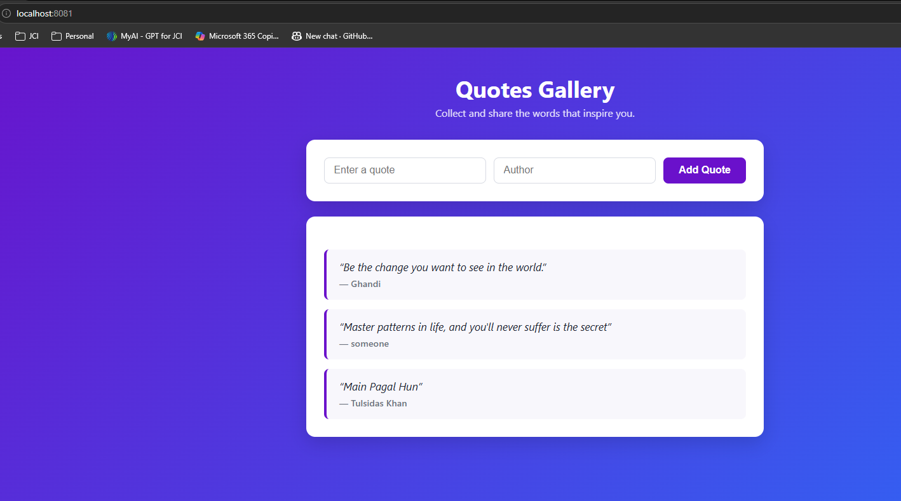

# 3-Tier Kubernetes Deployment — Quotes Application

A 3-tier Quotes application (MySQL + API + Frontend) that can run locally with Docker Compose or be deployed to Kubernetes.

- **Database (`db`)**: MySQL, seeded with [db/init.sql](db/init.sql).
- **API (`api`)**: Node.js + Express + `mysql2`, exposes `/api/quotes` (GET/POST) and `/health`. See [api/api.js](api/api.js).
- **Frontend (`app`)**: Node.js + Express + EJS, renders quotes and posts new ones via the API. See [app/app.js](app/app.js).
- **Ingress Controller**: nginx ingress, routes external traffic to the frontend.

> Previously the `api` and `app` services were written in Python/Flask. They have been rewritten in Node.js/Express.

## Prerequisites

- Docker & Docker Compose (for local development)
- Kubernetes cluster (Minikube/K3s/EKS/etc.) + `kubectl` (for deployment)
- A container registry (Docker Hub or similar) if deploying to Kubernetes

## Local Development (Docker Compose)



Build and run all three services:

```sh
docker compose build
docker compose up -d
```

Or use the helper script: [scripts/compose/compose.sh](scripts/compose/compose.sh).

- Frontend: http://localhost:5002
- API: http://localhost:5001/api/quotes

Stop everything:

```sh
docker compose down
```

Useful MySQL debugging commands are in [scripts/db/mysql-shell.sh](scripts/db/mysql-shell.sh).

## Kubernetes Deployment

Manifests live in [k8s/](k8s), organized by tier. Two helper scripts cover the whole flow below — [scripts/k8s/deploy.sh](scripts/k8s/deploy.sh) (build, import, deploy, verify, access) and [scripts/k8s/destroy.sh](scripts/k8s/destroy.sh) (tear down) — the sections underneath explain what they do step by step.

See the [Kubernetes architecture flowchart](architecture-flow.md) for how external requests reach the frontend and how the frontend, API, and database communicate.

| File | Purpose |
|---|---|
| [k8s/namespaces.yaml](k8s/namespaces.yaml) | Creates the `database`, `backend`, `frontend`, `ingress-nginx`, `logging` namespaces |
| [k8s/database/secret.yaml](k8s/database/secret.yaml) | MySQL credentials (`mysql-secret`), namespace: `database` |
| [k8s/database/configmap.yaml](k8s/database/configmap.yaml) | MySQL config (`mysql-config`), namespace: `database` |
| [k8s/database/statefulset.yaml](k8s/database/statefulset.yaml) | MySQL `StatefulSet` + `Service` (namespace: `database`) |
| [k8s/backend/secret.yaml](k8s/backend/secret.yaml) / [k8s/backend/configmap.yaml](k8s/backend/configmap.yaml) | Copies of the MySQL credentials/config in the `backend` namespace (Secrets/ConfigMaps are namespace-scoped, so the API can't read the `database` namespace's copies) |
| [k8s/backend/deployment.yaml](k8s/backend/deployment.yaml) | API `Deployment` + `Service` (namespace: `backend`); also mounts the shared `app-logs` hostPath volume (see [Centralized log collection](#5-centralized-log-collection-fluent-bit--loki)) |
| [k8s/frontend/deployment.yaml](k8s/frontend/deployment.yaml) | Frontend `Deployment` + `Service` (namespace: `frontend`); also mounts the shared `app-logs` hostPath volume |
| [k8s/frontend/ingress.yaml](k8s/frontend/ingress.yaml) | Host-agnostic Ingress rule routing `/` to the frontend Service |
| [k8s/ingress-nginx/controller.yaml](k8s/ingress-nginx/controller.yaml) | nginx ingress controller (Deployment, RBAC, `IngressClass`, NodePort `Service`) |
| [k8s/logging/rbac.yaml](k8s/logging/rbac.yaml) | `ServiceAccount` + `ClusterRole`/`ClusterRoleBinding` letting Fluent Bit read pod/namespace metadata (namespace: `logging`) |
| [k8s/logging/configmap.yaml](k8s/logging/configmap.yaml) | Fluent Bit config: tails node container log files **and** the app's structured log files, enriches with Kubernetes metadata, writes to a file **and** ships to Loki |
| [k8s/logging/pvc.yaml](k8s/logging/pvc.yaml) | `PersistentVolumeClaim` backing the aggregated log output files |
| [k8s/logging/daemonset.yaml](k8s/logging/daemonset.yaml) | Fluent Bit `DaemonSet` (one pod per node, namespace: `logging`) |
| [k8s/logging/loki/configmap.yaml](k8s/logging/loki/configmap.yaml) | Loki config (filesystem/TSDB storage, single-binary mode) — in its own subfolder so `kubectl apply -f k8s/logging` never applies it implicitly; see [§5](#5-centralized-log-collection-fluent-bit--loki) |
| [k8s/logging/loki/pvc.yaml](k8s/logging/loki/pvc.yaml) | `PersistentVolumeClaim` backing Loki's chunk/index storage |
| [k8s/logging/loki/deployment.yaml](k8s/logging/loki/deployment.yaml) | Loki `Deployment` (1 replica) + `Service` (`loki.logging.svc.cluster.local:3100`) |

This project pulls images from **Docker Hub** rather than relying on locally built/imported images, so it works the same on any cluster (k3s, Minikube, EKS, etc.).

### 1. Build, tag & push images to Docker Hub

```sh
docker login  # use a Docker Hub Personal Access Token, not your password

export DOCKERHUB_USER=anilpandeyio  # your Docker Hub namespace

docker compose build --no-cache
docker tag k8s-three-tier-starter-api:latest "$DOCKERHUB_USER/k8s-three-tier-starter-api:latest"
docker tag k8s-three-tier-starter-app:latest "$DOCKERHUB_USER/k8s-three-tier-starter-app:latest"
docker tag k8s-three-tier-starter-db:latest  "$DOCKERHUB_USER/k8s-three-tier-starter-db:latest"

docker push "$DOCKERHUB_USER/k8s-three-tier-starter-api:latest"
docker push "$DOCKERHUB_USER/k8s-three-tier-starter-app:latest"
docker push "$DOCKERHUB_USER/k8s-three-tier-starter-db:latest"
```

Or use the helper script — [scripts/docker/build-and-push.sh](scripts/docker/build-and-push.sh) — which does the same build/tag/push for all three images, but **skips any image whose directory (`db`/`api`/`app`) hasn't changed** since its last successful push (tracked via a content hash in the gitignored `.docker-build-state/` directory), so an unmodified service is never needlessly rebuilt or re-pushed:

```sh
export DOCKERHUB_USER=anilpandeyio  # optional, defaults to anilpandeyio
./scripts/docker/build-and-push.sh           # builds/pushes only what changed
./scripts/docker/build-and-push.sh api       # limit to one (or more) services
./scripts/docker/build-and-push.sh --force   # ignore the change check, rebuild everything
./scripts/docker/build-and-push.sh --help    # full usage
```

[k8s/backend/deployment.yaml](k8s/backend/deployment.yaml) and [k8s/frontend/deployment.yaml](k8s/frontend/deployment.yaml) pin an explicit version tag (e.g. `v1.0.4`) matching the repo's [VERSION](VERSION) file, kept in sync automatically: every merge to `main` bumps `VERSION`, pushes `api`/`app` images tagged with the new version, then has CI rewrite both manifests to that tag and commit the change back (see the `version` and `update-manifests` jobs in [.github/workflows/ci.yml](.github/workflows/ci.yml)). If you push images manually via the commands/script above (which publish `:latest`), update the tag in those two manifests yourself before applying, since they won't track an unmanaged `:latest` push. [k8s/database/statefulset.yaml](k8s/database/statefulset.yaml) still references `docker.io/<user>/k8s-three-tier-starter-db:latest` with `imagePullPolicy: Always`, so kubelet always pulls the latest pushed `db` image. If your repositories are private, create an `imagePullSecret` with your Docker Hub credentials and add it to each `spec.template.spec.imagePullSecrets` in the manifests. After pushing a new image, roll out the change:

```sh
kubectl rollout restart deployment/quotes-api-deployment -n backend
kubectl rollout restart deployment/quotes-frontend-deployment -n frontend
kubectl rollout restart statefulset/mysql -n database
```

### 2. Deploy to Kubernetes

```sh
# Namespaces first — everything else targets them
kubectl apply -f k8s/namespaces.yaml

# Apply all tiers in one command (each -f can be a directory of manifests).
# This deploys logging via Fluent Bit (file-based, no Loki); see "5. Centralized
# log collection" below to also add Loki by applying k8s/logging/loki.
kubectl apply -f k8s/database -f k8s/backend -f k8s/frontend -f k8s/ingress-nginx -f k8s/logging
```

### 3. Verify Deployment

```sh
kubectl get pods,svc -n database
kubectl get pods,svc -n backend
kubectl get pods,svc -n frontend
kubectl get pods,svc -n ingress-nginx
kubectl get pods -n logging
kubectl get ingress -n frontend

# Watch pods across all app namespaces until they're Running
kubectl get pods -n database -n backend -n frontend -n logging --watch
```

If a pod is stuck (e.g. `CreateContainerConfigError`, `ImagePullBackOff`), tail its logs:

```sh
kubectl logs -n backend -l app=quotes-api --tail=100 -f
```

### 4. Access the Application

[k8s/frontend/ingress.yaml](k8s/frontend/ingress.yaml) has no `host` restriction (matches any Host header), so the simplest and most stable way in — especially on WSL, where the node IP can change — is `kubectl port-forward` straight to `localhost`:

```sh
# pick any free local port; 8080 may already be in use on your machine
kubectl port-forward -n ingress-nginx svc/ingress-nginx-controller 8081:80
```

Then, in another terminal (or the Windows browser, since WSL2 shares `localhost` with Windows):

```sh
curl http://localhost:8081
# or open http://localhost:8081 in the browser
```

No hosts-file edits and no tracking the node IP are needed — the port-forward stays valid as long as that command is running.

### 5. Centralized log collection (Fluent Bit + Loki)

> **Is Loki required?** No. Fluent Bit's `file` output writes the aggregated log data straight to the PVC described below independently of Loki — that part works with zero extra setup. Loki is an *additional* sink that makes the same data queryable (LogQL, Grafana, etc.) instead of only `grep`-able in a flat file. Loki lives in its own subfolder, [k8s/logging/loki/](k8s/logging/loki), specifically so it's never applied by accident: `kubectl apply -f k8s/logging` is **not recursive**, so it only ever deploys Fluent Bit. If you don't apply `k8s/logging/loki`, Fluent Bit's `loki` output will just retry/fail quietly in the background (see its logs) while the `file` output keeps working.

[k8s/logging/](k8s/logging) runs:

- **Fluent Bit** as a `DaemonSet` (one pod per node, namespace: `logging`), which:
  1. Tails every container's log file on the node from `/var/log/containers/*.log` (where Kubernetes writes/symlinks container stdout/stderr).
  2. **Also tails the Quotes API/frontend's own structured log files** from `/var/log/quotes-app/*.log` — a hostPath volume the apps write to directly (see below) — parsing each line as JSON.
  3. Enriches container-tailed records with Kubernetes metadata (pod, namespace, container, labels) via the `kubernetes` filter (needs the `ClusterRole` in [k8s/logging/rbac.yaml](k8s/logging/rbac.yaml)).
  4. Writes both streams to files on a PVC (`aggregated-pods.log`, `aggregated-app.log`) **and** ships both to Loki as two labeled streams (`source=kube-containers`, `source=app-file`) — if Loki is deployed.
- **Loki** ([k8s/logging/loki/](k8s/logging/loki)) as a single-replica `Deployment` + `Service` (`loki.logging.svc.cluster.local:3100`), storing chunks/index on its own PVC via the filesystem/TSDB backend — no external object storage needed for this starter-sized setup.

**Writing application logs to a file over a shared volume:** [api/src/logger.js](api/src/logger.js) and [app/src/logger.js](app/src/logger.js) write every request/error as a JSON line to both stdout (unchanged `kubectl logs` behavior) and, when `LOG_DIR` is set, to `$LOG_DIR/$SERVICE_NAME-$HOSTNAME.log`. [k8s/backend/deployment.yaml](k8s/backend/deployment.yaml) and [k8s/frontend/deployment.yaml](k8s/frontend/deployment.yaml) set `LOG_DIR=/var/log/quotes-app` and mount a `hostPath` volume at that same path — which sits under the node's `/var/log`, already mounted read-only into the Fluent Bit DaemonSet, so no extra DaemonSet volume was needed. The `$HOSTNAME` (pod name) suffix keeps replicas on the same node from clobbering each other's file.

Deploy logging without Loki (file-only — also what step 2 above does):

```sh
kubectl apply -f k8s/logging
```

Add Loki on top, whenever you want it (applies independently of the rest of the stack):

```sh
kubectl apply -f k8s/logging/loki
```

Remove just Loki, leaving Fluent Bit's file-based logging untouched:

```sh
kubectl delete -f k8s/logging/loki
```

To verify logs are reaching Loki (confirmed working via these exact commands):

```sh
kubectl get pods -n logging -o wide                   # one fluent-bit pod per node + 1 loki pod
kubectl logs -n logging -l app=fluent-bit --tail=50    # watch for "loki" output errors/successes
kubectl logs -n logging -l app=loki --tail=50          # Loki's own startup/query logs

# Query Loki's HTTP API directly (LogQL) from inside the cluster
kubectl run loki-query -n logging --rm -it --restart=Never --image=curlimages/curl:8.11.0 -- sh -c '
  echo "--- known labels ---";
  curl -s "http://loki.logging.svc.cluster.local:3100/loki/api/v1/labels";
  echo;
  echo "--- app-file logs from the frontend ---";
  curl -s -G "http://loki.logging.svc.cluster.local:3100/loki/api/v1/query_range" \
    --data-urlencode "query={source=\"app-file\", service=\"quotes-frontend\"}" \
    --data-urlencode "limit=5";
  echo;
  echo "--- container logs from the backend namespace ---";
  curl -s -G "http://loki.logging.svc.cluster.local:3100/loki/api/v1/query_range" \
    --data-urlencode "query={kubernetes_namespace_name=\"backend\"}" \
    --data-urlencode "limit=5";
'
```

A non-empty `result` array (with each stream's `labels` and `values`) confirms logs made it through Fluent Bit into Loki. Useful label keys to filter on: `source` (`kube-containers` or `app-file`), `service` (from the app logger, e.g. `quotes-api`/`quotes-frontend`), `kubernetes_namespace_name`, `kubernetes_pod_name`, `kubernetes_container_name`, and `job=fluent-bit`.

To inspect the raw aggregated files on the PVC instead (works with or without Loki):

```sh
# The fluent-bit image has no shell, so use a throwaway pod to read the PVC
kubectl run pvc-inspector -n logging --image=busybox:1.36 --restart=Never --rm -it \
  --overrides='{"spec":{"containers":[{"name":"pvc-inspector","image":"busybox:1.36","command":["sh","-c","tail -n 50 /output/aggregated-pods.log; echo ---; tail -n 50 /output/aggregated-app.log"],"volumeMounts":[{"name":"out","mountPath":"/output"}]}],"volumes":[{"name":"out","persistentVolumeClaim":{"claimName":"fluent-bit-output-pvc"}}]}}'
```

> **Single-node vs. multi-node clusters:** the Fluent Bit output PVC and the Loki data PVC both use `ReadWriteOnce`, matching this starter's default `StorageClass` (e.g. Minikube/k3s `local-path`). That's fine for Loki (single replica) and for a single-node cluster. On a multi-node cluster, only the node that owns the Fluent Bit output PVC can mount it, so Fluent Bit pods on other nodes would fail to start — switch to a `ReadWriteMany`-capable `StorageClass` (e.g. NFS, EFS) or a per-node `hostPath` output in that case. The app-log `hostPath` volume has no such constraint: each node's own Fluent Bit pod only ever reads that node's local files.

### Cleanup

```sh
./scripts/k8s/destroy.sh
# equivalent to:
kubectl delete -f k8s/logging/loki -f k8s/logging -f k8s/ingress-nginx -f k8s/frontend -f k8s/backend -f k8s/database -f k8s/namespaces.yaml --ignore-not-found
```

## Notes

- `mysql-secret` and `mysql-config` must exist in **both** `database` and `backend` namespaces before deploying (Secrets/ConfigMaps don't cross namespace boundaries) — see [k8s/database/secret.yaml](k8s/database/secret.yaml) / [k8s/backend/secret.yaml](k8s/backend/secret.yaml).
- Adjust the Ingress host/rules in [k8s/frontend/ingress.yaml](k8s/frontend/ingress.yaml) based on your environment.
- All of the above is scripted in [scripts/k8s/deploy.sh](scripts/k8s/deploy.sh) — run it top to bottom, or copy/paste individual blocks as needed.