# Kubernetes 3-Tier Architecture Flow

This diagram shows how a request travels through the Quotes application deployed by the Kubernetes manifests.

```mermaid
flowchart LR
    user["External user<br/>Browser"]

    subgraph access["External access"]
        portForward["kubectl port-forward<br/>localhost:8081 → ingress Service :80"]
        nodePort["Reachable node IP : assigned NodePort<br/>for HTTP/HTTPS"]
    end

    subgraph cluster["Kubernetes cluster"]
        subgraph ingressNs["Namespace: ingress-nginx"]
            ingressService["ingress-nginx-controller Service<br/>NodePort"]
            controller["nginx Ingress Controller"]
        end

        subgraph frontendNs["Namespace: frontend"]
            ingressRule["Ingress rule<br/>HTTP path /, any host"]
            frontendService["quotes-frontend-service<br/>ClusterIP :5002"]
            frontend["Frontend Deployment<br/>2 app pods :5002"]
        end

        subgraph backendNs["Namespace: backend"]
            apiService["api Service<br/>ClusterIP :5001"]
            api["API Deployment<br/>2 API pods :5001"]
        end

        subgraph databaseNs["Namespace: database"]
            mysqlService["mysql Service<br/>ClusterIP :3306"]
            mysql["MySQL StatefulSet<br/>persistent volume"]
        end
    end

    user -->|"Recommended local access"| portForward
    user -->|"When node network/firewall allows"| nodePort
    portForward --> ingressService
    nodePort --> ingressService
    ingressService --> controller
    controller --> ingressRule
    ingressRule -->|"Service port 5002"| frontendService
    frontendService --> frontend
    frontend -->|"API_URL: api.backend.svc.cluster.local:5001"| apiService
    apiService --> api
    api -->|"MYSQL_HOST: mysql.database.svc.cluster.local:3306"| mysqlService
    mysqlService --> mysql

    mysql -. "Query results" .-> api
    api -. "API response" .-> frontend
    frontend -. "Rendered page / response" .-> user
```



## Request flow

1. The user opens the application through either the documented port-forward or a reachable node's NodePort. The port-forward command is:

   ```sh
   kubectl port-forward -n ingress-nginx svc/ingress-nginx-controller 8081:80
   ```

   Then browse to `http://localhost:8081`. This is a tunnel from the machine running `kubectl`; it does not itself publish the application to the public internet. Direct NodePort access requires a reachable node IP and network/firewall access to the assigned NodePort.

2. The nginx Ingress Controller applies the Ingress rule in the `frontend` namespace. The rule has no host restriction and sends `/` to `quotes-frontend-service` on port `5002`.

3. The frontend Service routes to one of the frontend pods. The frontend is a server-side application: it requests data from the API and returns rendered pages to the user's browser.

4. The frontend reaches the API using its Kubernetes Service DNS name, `api.backend.svc.cluster.local`, on port `5001`. The API Service routes to an API pod.

5. The API reaches MySQL through `mysql.database.svc.cluster.local` on port `3306`. The MySQL Service routes to the database pod, whose data is stored on a persistent volume.

6. Responses return through the same application tiers to the user's browser. The browser does not connect directly to the API or database.

The Services between tiers are internal `ClusterIP` Services. The `cluster.local` suffix is the cluster's default DNS domain in this configuration; a cluster administrator can configure a different domain.
